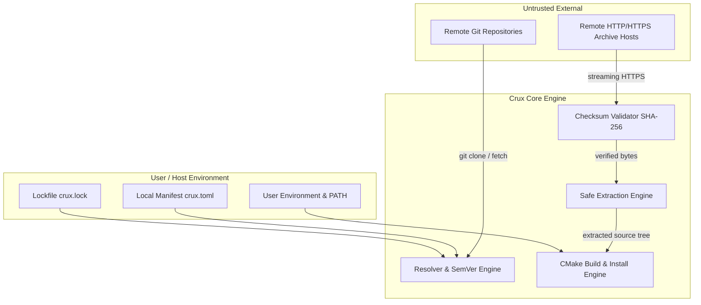

# Crux Security Model & Threat Assessment

**Document Status**: Current  
**Version**: 0.2.0  
**Last Updated**: 2026-11-15  

---

## 1. Executive Summary

Crux is a source-first C/C++ package manager. It acquires package definitions from Git repositories, downloads source archives over HTTPS, extracts archives, compiles packages using CMake, stages installations, and generates build-system integration files.

Security in Crux is designed around **defense-in-depth**, **least-surprise execution**, and **unambiguous trust boundaries**. This document details Crux's security guarantees, trust assumptions, process privilege reality, and operational mitigations.

---

## 2. Process Privileges & Sandbox Reality

> [!CAUTION]
> **No OS-Level Sandbox in v0.2.0**: Crux does **not** execute CMake, compilers, or build scripts inside an isolated container, namespace, or seccomp jail. External processes run with the full ambient privileges of the user executing `crux`.

### Current Execution Model
When `crux build` or `crux install` is invoked:
1. Crux invokes CMake (`cmake -B <build_dir> -S <source_dir>`) and the compiler toolchain directly via `std::process::Command`.
2. Any `CMakeLists.txt` file or custom build command executed by CMake runs with the permissions of the current user.
3. CMake scripts have unrestricted access to the user's filesystem, network, and environment variables within the constraints of the host operating system.

### Mitigations in Crux
Crux enforces strict subprocess safeguards:
- **Zero Shell Interpolation**: All subprocesses (`cmake`, `git`, compiler invocations) are launched strictly with discrete argument arrays (`Command::arg`, `Command::args`). Crux **never** invokes shell wrappers (`sh -c`, `bash -c`, or `cmd.exe /C`), eliminating shell injection and metacharacter expansion vulnerabilities.
- **Confinement of Working Directories**: Every subprocess is bound to an explicit working directory (`Command::current_dir`), preventing accidental execution or file creation in the user's current directory.
- **Path Escaping in Integration Scripts**: Generated integration scripts (`.crux/cmake/CruxDependencies.cmake`) escape all embedded paths (quotes, semicolons, dollar signs) and reject embedded newlines or null bytes to prevent CMake code injection.

### Planned Hardening (Post-v0.2.0)
Future milestones plan optional containerized or namespaced build isolation:
- Linux: `bubblewrap` (`bwrap`) or user namespace isolation with read-only root filesystems and disabled network access during compilation.
- macOS: `sandbox-exec` profiles.

---

## 3. Threat Model & Trust Boundaries

Crux interacts with five distinct trust boundaries:

### Trust Boundary Evaluation

| Component | Trust Level | Failure Mode & Crux Protection |
|---|---|---|
| **User Manifest (`crux.toml`)** | Local User Trust | Validated with strict TOML schema; invalid names, versions, or constraints cause immediate hard exit without execution. |
| **Lockfile (`crux.lock`)** | Local User / Repo Trust | Canonical TOML serialization with byte-for-byte reproducibility; sync checks detect tampering or manifest drift. |
| **Git Registries** | Semi-Trusted Index | Cloned via explicit `git clone` arguments; manifests validated against strict schemas before acceptance; malicious paths rejected. |
| **HTTP(S) Downloads** | Untrusted Transport | TLS enforced; exact SHA-256 digest verified prior to cache storage or extraction; hash mismatch aborts and removes temporary file. |
| **Source Archives** | Untrusted Data | Decompression bomb limits (size, count, ratio); Zip Slip path traversal checks; symlink escape jail. |
| **CMake Build Scripts** | Code Execution Boundary | Runs with ambient user privileges; relies on trusted registry curation and user review. |

---

## 4. Archive Extraction Safety

Archive extraction (`.tar`, `.tar.gz`, `.zip`) represents a major attack surface in package managers. Crux implements five defensive layers:

### 1. Zip Slip Protection (Path Traversal)
Every archive entry's destination path is canonicalized and verified against the extraction target root:
- Entries containing `..` or leading `/` are inspected.
- Crux verifies that `resolved_path.starts_with(&extraction_root)`. If an entry attempts to escape the root directory, extraction terminates immediately with an `AcquisitionError::ZipSlip` error, and all extracted files are purged.

### 2. Symlink Escape Jail
Archives containing symbolic links can be exploited to overwrite arbitrary files outside the target directory:
- Crux inspects all symlink targets inside archives and during staging validation.
- Any symbolic link whose resolved target points outside the extraction or staging directory is rejected as a security violation.

### 3. Decompression Bomb Defenses
To prevent denial-of-service via algorithmic archive bombs, Crux enforces strict resource ceilings:
- **Maximum Uncompressed Size**: 500 MB per archive.
- **Maximum File Count**: 50,000 files per archive.
- **Maximum Compression Ratio**: 100:1 limit to detect high-expansion zip bombs.
- **Streaming Byte Counting**: File sizes are tracked during decompression; if limits are exceeded, extraction aborts mid-stream.

---

## 5. Network Security & Cryptographic Integrity

### TLS Transport
- All remote downloads require HTTPS. Unencrypted HTTP endpoints are rejected for external source acquisition.
- Crux utilizes `ureq` configured with native platform TLS roots.

### Cryptographic Digest Verification
- Every package archive in the registry must specify a cryptographic checksum (`sha256:<hex_digest>`).
- Crux streams the downloaded bytes through a `sha2::Sha256` hasher in real time.
- The computed hash is compared in constant time with the declared checksum.
- If the checksum fails:
  1. The download is immediately aborted.
  2. The partially downloaded temporary file is erased.
  3. A hard `AcquisitionError::ChecksumMismatch` error is reported to the user, displaying both expected and actual digests.
  4. The corrupted payload is never cached or extracted.

---

## 6. Filesystem Safety & Atomic Operations

### Atomic File Writes
Lockfiles (`crux.lock`), configuration files (`config.toml`), and CMake integration scripts (`CruxDependencies.cmake`) are written atomically:
1. Content is written to a temporary sibling file in the target directory (e.g., `.crux.lock.tmp.<nonce>`).
2. The file is flushed to disk (`flush()` and `sync_all()`).
3. The temporary file is atomically renamed over the destination file using `fs::rename`.
4. If a process crash or power interruption occurs, the destination file remains uncorrupted.

### Staging and Atomic Publication
Package installation uses an atomic two-stage pipeline:
1. `cmake --install` runs into an isolated staging directory (`.crux/staging/<pkg>/<version>/<fingerprint>/`).
2. Crux inspects and classifies all staged files, builds an `installed.toml` inventory, and checks for symlink escapes.
3. Upon validation, the staging directory is atomically moved to `.crux/installed/<pkg>/<version>/<fingerprint>/`.
4. If installation or validation fails at any point, the staging directory is wiped cleanly, leaving any previously installed version intact.

---

## 7. Reporting Security Issues

If you discover a security vulnerability in Crux, please report it responsibly:
- **Email**: [security@crux-pkg.invalid] *(or create a confidential GitHub Security Advisory)*
- Please do not open public GitHub issues for undisclosed security vulnerabilities.
- Provide a detailed report including steps to reproduce, impact assessment, and proof-of-concept manifests/archives where applicable.
