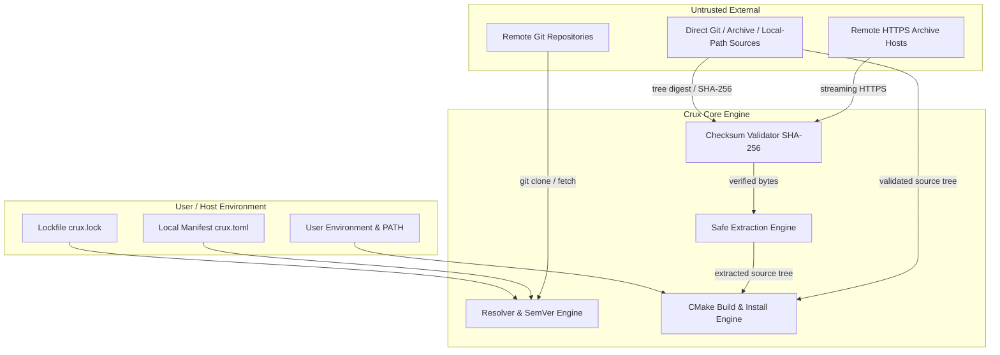

# Crux Security Model & Threat Assessment

**Document Status**: Current  
**Version**: 0.2.1  
**Last Updated**: 2026-11-20  

---

## 1. Executive Summary

Crux is a source-first C/C++ package manager. It acquires package definitions from Git repositories, downloads source archives over HTTPS, extracts archives, compiles packages using CMake, stages installations, and generates build-system integration files.

Security in Crux is designed around **defense-in-depth**, **least-surprise execution**, and **unambiguous trust boundaries**. This document details Crux's security guarantees, trust assumptions, process privilege reality, and operational mitigations.

---

## 2. Process Privileges & Sandbox Reality

> [!CAUTION]
> **No OS-Level Sandbox in v0.2.1**: Crux does **not** execute CMake, compilers, or build scripts inside an isolated container, namespace, or seccomp jail. External processes run with the full ambient privileges of the user executing `crux`. This is unchanged from v0.2.0, and it applies to **untrusted direct sources** (Git, archive, and local-path dependencies) as well as registry packages: their build trees can still execute external build tools with ambient privileges. Validate and trust any direct source before building it, or run Crux inside your own isolated environment.

### Current Execution Model
When `crux build` or `crux install` is invoked:
1. Crux invokes CMake (`cmake -B <build_dir> -S <source_dir>`) and the compiler toolchain directly via `std::process::Command`.
2. Any `CMakeLists.txt` file or custom build command executed by CMake runs with the permissions of the current user.
3. CMake scripts have unrestricted access to the user's filesystem, network, and environment variables within the constraints of the host operating system.

### Mitigations in Crux
Crux enforces strict subprocess safeguards:
- **Zero Shell Interpolation**: All subprocesses (`cmake`, `git`, compiler invocations) are launched strictly with discrete argument arrays (`Command::arg`, `Command::args`). Crux **never** invokes shell wrappers (`sh -c`, `bash -c`, or `cmd.exe /C`), eliminating shell injection and metacharacter expansion vulnerabilities.
- **Confinement of Working Directories**: Every subprocess is bound to an explicit working directory (`Command::current_dir`), preventing accidental execution or file creation in the user's current directory.
- **Path Escaping in Integration Scripts**: Generated integration scripts (`.crux/cmake/CruxDependencies.cmake`) escape all embedded paths (quotes, semicolons, dollar signs) and reject embedded newlines or null bytes to prevent CMake code injection.

### Planned Hardening (Post-v0.2.1)
Future milestones plan optional containerized or namespaced build isolation:
- Linux: `bubblewrap` (`bwrap`) or user namespace isolation with read-only root filesystems and disabled network access during compilation.
- macOS: `sandbox-exec` profiles.

---

## 3. Threat Model & Trust Boundaries

Crux interacts with five distinct trust boundaries:



### Trust Boundary Evaluation

| Component | Trust Level | Failure Mode & Crux Protection |
|---|---|---|
| **User Manifest (`crux.toml`)** | Local User Trust | Validated with strict TOML schema; invalid names, versions, or constraints cause immediate hard exit without execution. |
| **Lockfile (`crux.lock`)** | Local User / Repo Trust | Canonical TOML serialization with byte-for-byte reproducibility; sync checks detect tampering or manifest drift. |
| **Git Registries** | Semi-Trusted Index | Cloned via explicit `git clone` arguments; manifests validated against strict schemas before acceptance; malicious paths rejected. |
| **Direct Sources (Git / archive / local path)** | Untrusted Code & Data | Argv-only Git execution with null stdin and timeouts, immutable locked commits, HTTPS-only archives with SHA-256 before extraction, real deterministic tree digests, symlink-escape validation, and conflict/cycle checks. Build tools still run with ambient privileges. |
| **HTTPS Downloads** | Untrusted Transport | HTTPS required (plain HTTP rejected); exact SHA-256 digest verified prior to cache storage or extraction; hash mismatch aborts and removes temporary file. |
| **Source Archives** | Untrusted Data | Decompression bomb limits (size, count, ratio); Zip Slip path traversal checks; symlink escape jail. |
| **CMake Build Scripts** | Code Execution Boundary | Runs with ambient user privileges; relies on trusted registry curation and user review. |

---

## 4. Direct-Source Security

Direct Git, archive, and local-path dependencies pass through the same resolver, lockfile, build, and install pipeline as registry packages, but they add distinct trust boundaries. v0.2.1 hardens them as follows; see [Direct Package Sources](../guides/direct-sources.md) for the manifest grammar and operational details.

- **Git argv-only execution**: Git is invoked with discrete argument vectors (never a shell), with stdin closed (null) and a hard timeout. URLs and refs are restricted to a safe character set; leading-dash, traversal, control-character, and malformed `rev` values are rejected before any subprocess is spawned.
- **Refs resolved to immutable commits**: tags, branches, arbitrary revisions, and `HEAD` resolve to a full 40-character commit. The commit is recorded in `crux.lock` and is never silently advanced; `crux lock --update` is the explicit refresh path.
- **Archive SHA-256 before extraction**: every direct archive requires a digest, verified before the archive is cached or unpacked. Only HTTPS archive URLs are accepted; unencrypted `http://` endpoints are rejected.
- **Real deterministic tree digests**: Git and local-path trees receive actual SHA-256 source-tree digests in the `crux-source-tree-v2` format. `.git` is excluded at every depth; `.crux`, `build`, `target`, `cmake-build-*`, and cache sentinels are excluded only at the tree root, so nested source directories with those names are measured. These are content measurements, never placeholders.
- **Locked checksums are enforced**: archive and Git checksums recorded in `crux.lock` are verified on every acquisition, and re-locking never silently replaces them (see [Lockfile Integrity & Re-locking](#lockfile-integrity--re-locking)). Local path dependencies are intentionally mutable and are built from verified cache snapshots.
- **Direct/path tree symlink-escape validation**: symlinks resolving outside the validated source root are rejected before hashing, copying, or building.
- **Conflict and cycle checks**: a package name may come from the registry or from one direct source, never both. Registry-vs-direct and direct-vs-direct identity conflicts, and direct-source dependency cycles, are rejected during validation and resolution.
- **Git transport policy**: dependency URLs must use `https://`, `ssh://`, SCP-style `user@host:path`, `file://`, or a local path. Plain `http://`/`git://`, remote-helper transports (`ext::`, `fd::`, …), and embedded credentials are rejected. Registry URLs (`crux registry add`) follow the same transport policy but may embed credentials, which are always redacted from diagnostics. Every Git subprocess also runs with `GIT_ALLOW_PROTOCOL=https:ssh:file`, so Git refuses other transports even through redirects, and URLs are passed after `--` so they can never be parsed as options.
- **Bounded Git and build subprocesses**: Git and build tools run with hard timeouts covering the whole lifecycle. On timeout the process **and its descendants** (for example `git-remote-https`, `ssh`, or compilers) are terminated with `SIGKILL` and reaped; descendants are found through `/proc` on Linux. Output pipes are drained continuously and readers get a bounded grace period, so a lingering process holding a pipe cannot hang Crux. Source-acquisition Git commands never prompt (`GIT_TERMINAL_PROMPT=0`); the explicit `crux registry add` and `crux registry update` commands may still prompt for credentials.

> [!WARNING]
> These controls protect acquisition and source-tree integrity. **Untrusted direct sources still execute external build tools (CMake and compilers) with ambient user privileges.** v0.2.1 includes no OS sandbox for direct sources; build only sources you trust, or run Crux inside your own isolated environment.

---

## 5. Archive Extraction Safety

Archive extraction (`.tar`, `.tar.gz`, `.zip`) represents a major attack surface in package managers. Crux implements layered extraction defenses (plus the direct-source tree validation described above):

### 1. Zip Slip Protection (Path Traversal)
Every archive entry's destination path is canonicalized and verified against the extraction target root:
- Entries containing `..` or leading `/` are inspected.
- Crux verifies that `resolved_path.starts_with(&extraction_root)`. If an entry attempts to escape the root directory, extraction terminates immediately with an `AcquisitionError::ZipSlip` error, and all extracted files are purged.

### 2. Symlink Escape Jail
Archives containing symbolic links can be exploited to overwrite arbitrary files outside the target directory:
- Crux inspects all symlink targets inside archives and during staging validation.
- Any symbolic link whose resolved target points outside the extraction or staging directory is rejected as a security violation.

### 3. Decompression Bomb Defenses
To prevent denial-of-service via algorithmic archive bombs, Crux enforces strict resource ceilings:
- **Maximum Uncompressed Size**: 1 GB per archive.
- **Maximum File Count**: 50,000 files per archive.
- **Maximum Compression Ratio**: 100:1 limit to detect high-expansion zip bombs.
- **Streaming Byte Counting**: File sizes are tracked during decompression; if limits are exceeded, extraction aborts mid-stream.

---

## 6. Network Security & Cryptographic Integrity

### TLS Transport
- All remote downloads require HTTPS. Unencrypted `http://` endpoints are rejected for both registry package acquisition and direct archive sources.
- Crux utilizes `ureq` configured with native platform TLS roots.

### Cryptographic Digest Verification
- Every package archive in the registry must specify a cryptographic checksum (`sha256:<hex_digest>`).
- Crux streams the downloaded bytes through a `sha2::Sha256` hasher in real time.
- The computed digest is normalized (case/prefix) and compared with the declared checksum; a mismatch is a hard error. No constant-time comparison is claimed.
- If the checksum fails:
  1. The download is immediately aborted.
  2. The partially downloaded temporary file is erased.
  3. A hard `AcquisitionError::ChecksumMismatch` error is reported to the user, displaying both expected and actual digests.
  4. The corrupted payload is never cached or extracted.

### Lockfile Integrity & Re-locking

`crux.lock` records an integrity identity (`checksum = "sha256:..."`) for every package:

| Source kind | What the checksum measures | Guarantee |
|---|---|---|
| Registry archive / direct archive | SHA-256 of the archive file | **Immutable.** Verified before any download and again while streaming. |
| Git (pinned commit) | Deterministic source-tree digest of the checked-out commit | **Immutable.** The commit and its tree digest are re-verified on every acquisition. |
| Local path | Source-tree digest of the working copy at lock time | **Mutable by design** (see below). |

**Enforcement during acquisition.** `crux fetch`, `crux build`, and `crux install` compare the acquired content with the locked checksum. A mismatch for an archive or Git source is a hard error (`AcquisitionError::LockedChecksumMismatch`), reported before any archive is downloaded.

**Re-locking never silently replaces a checksum.** When a normal `crux lock`, or a lockfile rewrite caused by `crux add`/`crux remove`, regenerates `crux.lock`, it keeps the existing checksum of every package whose **name, version, and source identity are unchanged**. If the registry or source now reports a *different* checksum for that same version and source, Crux stops with an integrity error that names the package, the source, and both checksums. `crux.lock` is left untouched.

**Accepting a changed checksum on purpose.** After you have verified the new content (for example, an upstream re-tagged release), run:

```bash
crux lock --update
```

`--update` re-resolves versions and Git refs *and* explicitly accepts changed checksums for already-locked packages. Every accepted change is printed as a warning with the package, the old checksum, and the new checksum, so the decision is visible in CI logs and code review.

**What is not an integrity change.** Upgrading to a different version, or changing a dependency's source identity (a new Git commit or ref, a new archive URL or digest in `crux.toml`), creates a new package identity. Its checksum is recorded normally, without `--update`.

**Mutable local path dependencies.** `path = "..."` dependencies are working copies meant for active development. Their checksum is refreshed by `crux lock` and is **not** enforced during acquisition, so editing a local dependency never causes a checksum failure. Builds still never read the live directory: every acquisition hashes the tree, copies it into the content-addressed cache, re-hashes the copy, and builds from that verified snapshot. Path dependencies therefore do **not** provide the immutability guarantees of pinned Git or archive dependencies. Do not rely on them for reproducible release builds.

**Legacy checksum format.** Source-tree digests use the `crux-source-tree-v2` format. It hashes only the executable bit (not umask-dependent permission bits), hashes file names as raw bytes, and filters build output only at the tree root. Lockfiles written by Crux v0.2.0 (and pre-release v0.2.1 builds) record Git digests in the older `v1` format. Those digests are still verified and accepted, and Crux prints a one-time warning per package explaining that the current format hashes consistently across machines. Running `crux lock` migrates them to v2. The migration is reported, needs no `--update`, and is only performed when the legacy digest provably describes the same content.

**Auditing checksums with `crux lock --check`.** `crux lock --check` compares every checksum in `crux.lock` with the metadata Crux already has locally. The audit itself never downloads or extracts a package archive, never builds, and never writes to the project: `crux.toml` and `crux.lock` stay byte-identical, and it never runs `--update` for you. Like every catalog-backed command, though, `--check` first loads the direct sources declared in `crux.toml`. A direct Git source missing from the local cache is cloned, local path sources are snapshotted into the cache, and a project with no configured registry bootstraps the official registry unless `CRUX_OFFLINE` is set. Each locked package gets one finding:

| Finding | Meaning | Result |
|---|---|---|
| `ok` | Registry (or cached direct source) records the same checksum | pass |
| `checksum-drift` | Same version and source, but a **different** checksum | **fail** |
| `version-missing` | Registry provides the package, but not the locked version | **fail** |
| `package-missing` | Registry no longer provides the package | **fail** |
| `source-changed` | The locked version is now provided from a different source identity | **fail** |
| `checksum-unavailable` | Registry metadata records no checksum for this version, so drift cannot be detected | warning |
| `lock-checksum-missing` | `crux.lock` records no checksum; `crux lock` will record it | warning |
| `legacy-checksum` | Legacy `v1` Git digest of the same content; `crux lock` migrates it | warning |
| `mutable-path` | Local path dependency, intentionally not compared | pass |

If the registry metadata cannot be loaded at all, the check reports `Status: Unverified (registry metadata unavailable)` and fails, because nothing could be compared.

**Trust boundary of the audit.** The comparison uses only the **locally available** registry checkout. A change published to the remote registry is invisible until that checkout is refreshed (`crux registry update <name>`, or updating the checkout yourself when using `CRUX_REGISTRY_PATH`). To audit against the latest registry state, refresh first, then run `crux lock --check`.

**Responding to findings.**
- For `checksum-drift`, treat it as a possible supply-chain event: verify the new upstream content first. Run `crux lock --update` only if the change is legitimate, never just to silence the error.
- For `version-missing` or `package-missing`, refresh the registry first, in case your local metadata is stale. If the version or package really was withdrawn, choose a replacement and re-lock.
- For `source-changed`, confirm the new source is intended, then re-lock with `crux lock`.

---

## 7. Filesystem Safety & Atomic Operations

### Atomic File Writes
Lockfiles (`crux.lock`), manifests edited by `crux add`/`crux remove`, configuration files (`config.toml`), build metadata, and CMake integration scripts (`CruxDependencies.cmake`) all use one atomic-write routine:
1. Content is written to a temporary sibling file in the destination directory (e.g. `.crux.lock.tmp.<pid>.<nonce>.<counter>`), so the final rename never crosses filesystems. The file is created exclusively (`O_EXCL`), so an existing file or symlink at that path is never followed or truncated.
2. On Unix, an existing destination keeps its permission bits. A new `config.toml`, which may contain registry URLs with credentials, is created owner-only (`0600`).
3. The data is flushed and synced (`sync_all()`), then atomically renamed over the destination with `fs::rename`. The parent directory is synced afterwards on a best-effort basis.
4. On any error the destination is left untouched and the temporary file is removed.

Readers therefore see either the complete old content or the complete new content. Crash durability is as strong as the filesystem's `fsync` semantics; a failed directory sync is not reported.

### Staging and Atomic Publication
Package installation uses an atomic two-stage pipeline:
1. `cmake --install` runs into an isolated staging directory (`.crux/staging/<pkg>/<version>/<fingerprint>/`).
2. Crux inspects and classifies all staged files, builds an `installed.toml` inventory, and checks for symlink escapes.
3. Upon validation, the staging directory is atomically moved to `.crux/installed/<pkg>/<version>/<fingerprint>/`.
4. If installation or validation fails at any point, the staging directory is wiped cleanly, leaving any previously installed version intact.

---

## 8. Reporting Security Issues

If you discover a security vulnerability in Crux, please report it responsibly:
- **Email**: [security@crux-pkg.invalid] *(or create a confidential GitHub Security Advisory)*
- Please do not open public GitHub issues for undisclosed security vulnerabilities.
- Provide a detailed report including steps to reproduce, impact assessment, and proof-of-concept manifests/archives where applicable.
